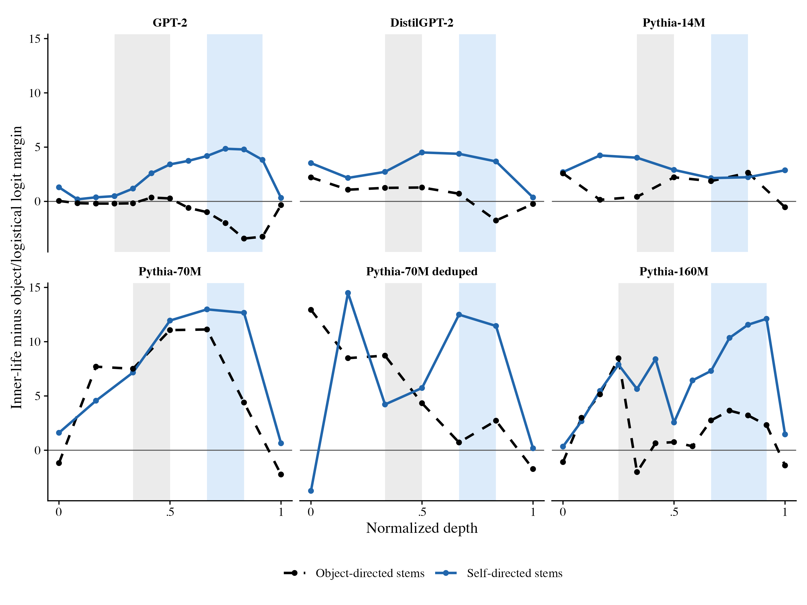

# Psychological Depth in Network Depth

Code, materials, and saved results for *Psychological Depth in Network Depth: Late-Intermediate Layers Support Self-Directed Inner-Life Sentence Completions*, by Matteo Perini.

The study asks when small autoregressive language models begin to support inner-life continuations after self-directed sentence stems. It compares layer-wise readouts across six models, tests convergence with a taxonomy of psychological depth, and uses lexical controls, calibrated readouts, and activation patching to examine the interpretation of the effect.

The main self/object contrast is positive in five of six models. Its scope is limited to the tested completion task: the 36 prompt pairs come from six template families, and candidate-label permutation results are mixed. The patching results establish a contribution of residual states to the measured completion margin; they do not identify a psychological-depth circuit.

## Start here

- [Reproduction instructions](REPRODUCE.md): check the saved results, regenerate the figures, or rerun selected analyses.
- [Analysis map](release/analysis_traceability.csv): links manuscript figures and tables to their scripts, inputs, and outputs.
- [Environment](ENVIRONMENT.md): recorded Python and R versions and installation instructions.
- [Verification record](release/verification.md): code integrity and comparisons with regenerated outputs.
- [Clean installation](release/clean_install_report.md): tested environment, dependency fixes, and numerical agreement.
- [Semantic stimulus audit](logit_lens_depth_mini/paper_sentence_completion_tests/posthoc_llm_semantic_audit/README.md): six local models' ratings of the candidate words, with raw responses and statistical results.

## Repository contents

| Location | Contents |
| --- | --- |
| `figures/main/` | Three manuscript figures, captions, and their R plotting script |
| `logit_lens_depth_mini/paper_sentence_completion_tests/data/` | Prompt stems and candidate-word sets |
| `logit_lens_depth_mini/paper_sentence_completion_tests/scripts/` | Completion probes, lexical controls, and patching helpers |
| `logit_lens_depth_mini/paper_sentence_completion_tests/analysis/robustness/` | Calibration, permutation, resampling, layer-window, and patching analyses |
| `logit_lens_depth_mini/paper_sentence_completion_tests/outputs/` | Saved model outputs and summaries |
| `logit_lens_depth_mini/paper_sentence_completion_tests/results/robustness/` | Canonical analysis data and robustness estimates |
| `logit_lens_depth_mini/paper_sentence_completion_tests/posthoc_llm_semantic_audit/` | Word ratings, response records, codebooks, R analyses, and a self-contained HTML report |
| `environment/` | Complete Python and R package versions from the clean installation |
| `release/` | File manifest, analysis map, and verification records |

The directory structure is retained because the scripts resolve their inputs relative to these paths. All included Python and R scripts are unchanged from the analysis sources. Numeric results, prompts, model settings, and scoring rules are preserved. Local machine prefixes have been removed from the `source_file` provenance column in three canonical data files; their other columns are unchanged.

## Reading the results

The main readout is a logsumexp margin between predefined candidate sets. Candidate-pool probabilities are relative to those sets, not probabilities over the whole vocabulary. A positive late-minus-middle contrast indicates increased support in the specified late-intermediate layer window. The final layer is treated separately.

The materials are constructed English sentence stems and word lists; the results are model outputs. The semantic audit uses LLM ratings of isolated words and provides no human norming data. Its raw responses, including unsuccessful attempts, are retained alongside the cleaned scores.

The saved results can be inspected without downloading model weights. Fresh inference may vary with checkpoint revisions, software, and hardware; matching the code alone does not establish bitwise reproducibility. See [REPRODUCE.md](REPRODUCE.md) for the distinction between saved-result checks and model reruns.

## Citation and licensing

Citation metadata are provided in [CITATION.cff](CITATION.cff). The manuscript link will be added when a preprint is available.

Original code is licensed under [MIT](LICENSE). Original materials, figures, and other non-code content are licensed under [CC BY 4.0](LICENSE-CC-BY-4.0.txt), to the extent that the author holds rights in them. See [LICENSE_NOTES.md](LICENSE_NOTES.md) for the scope and third-party terms.
